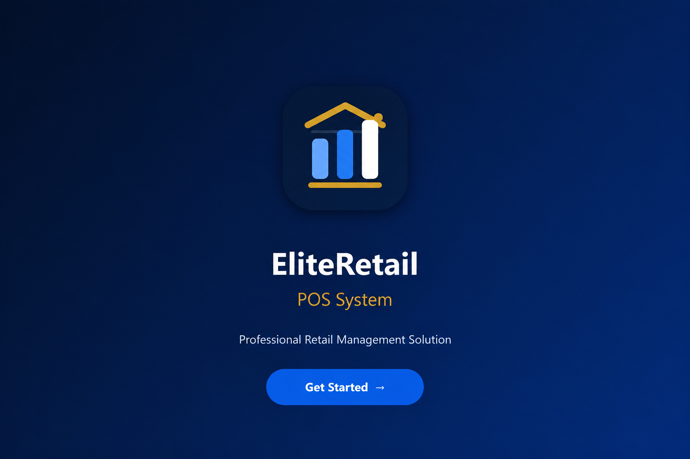
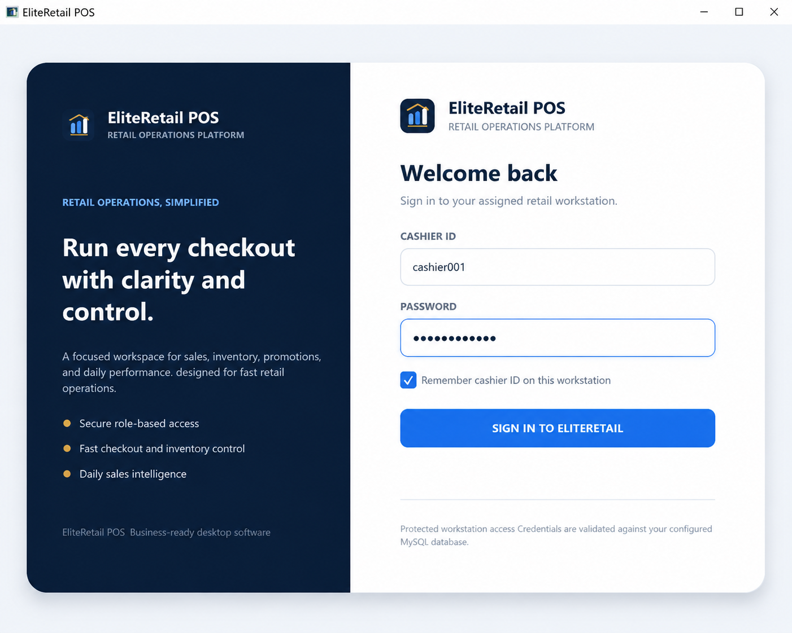
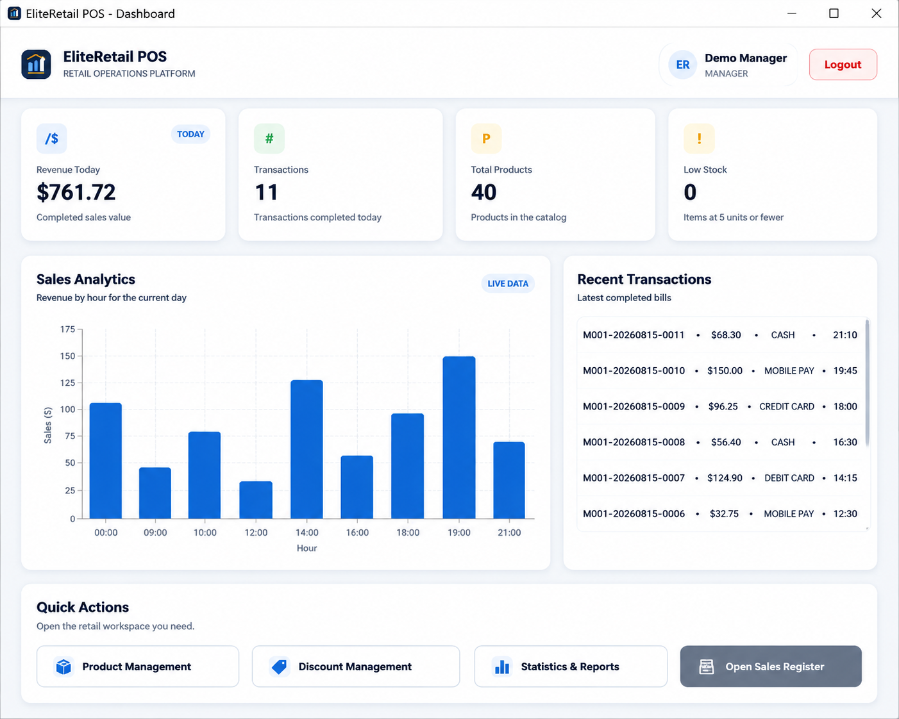
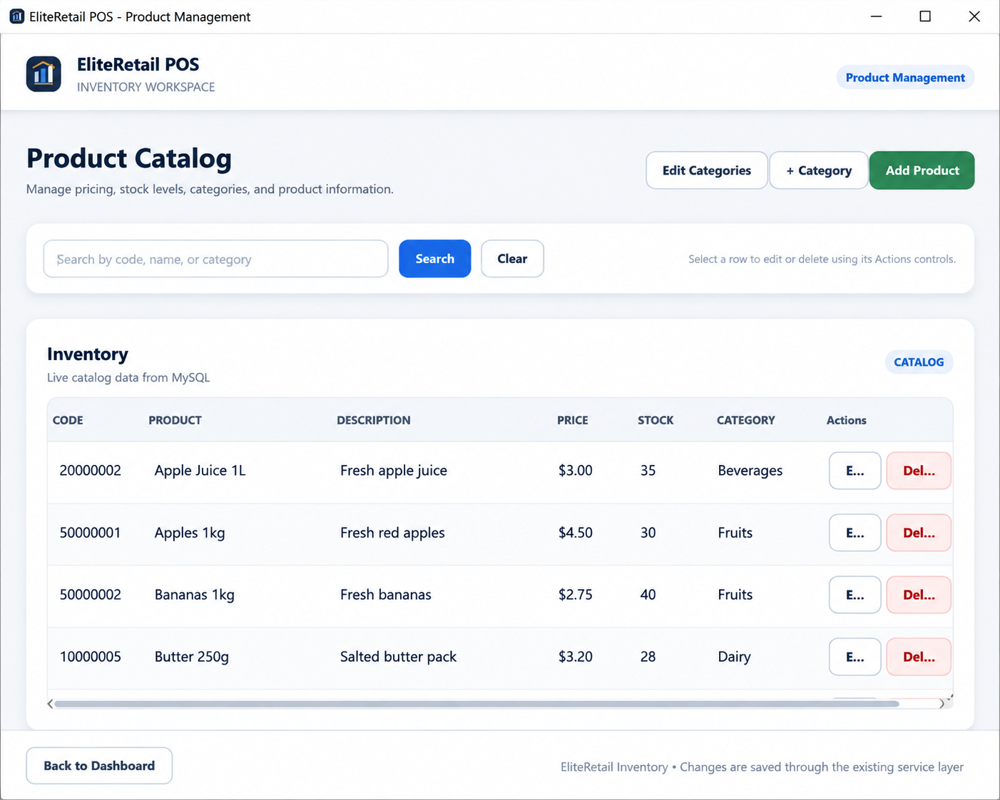
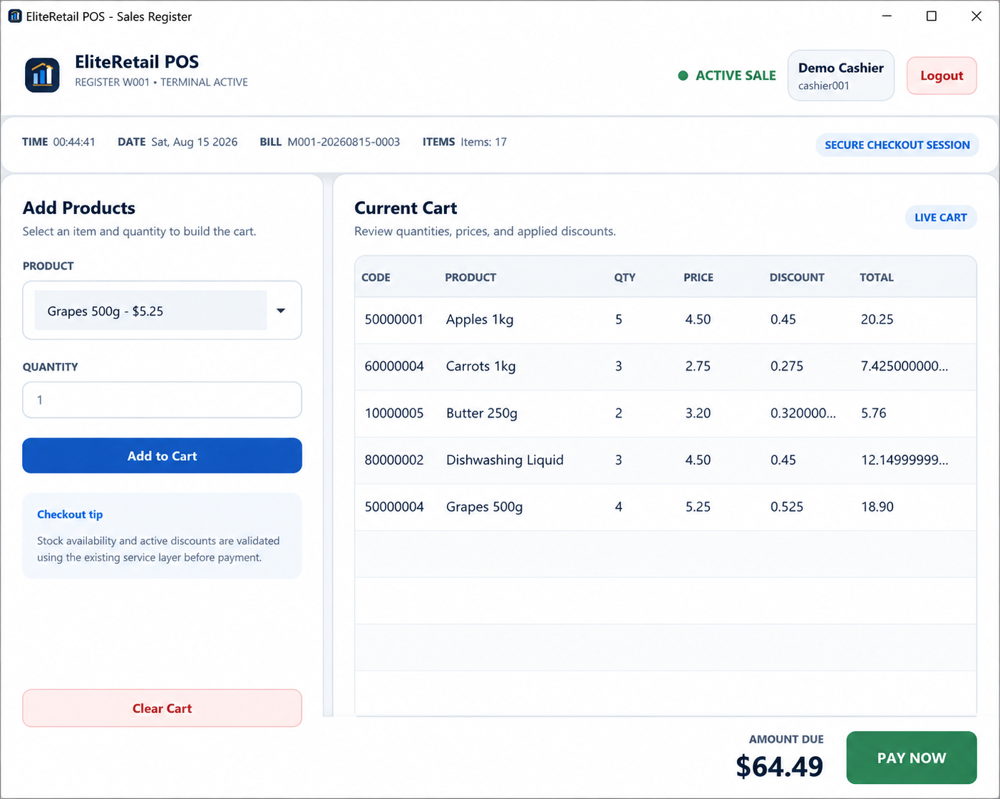
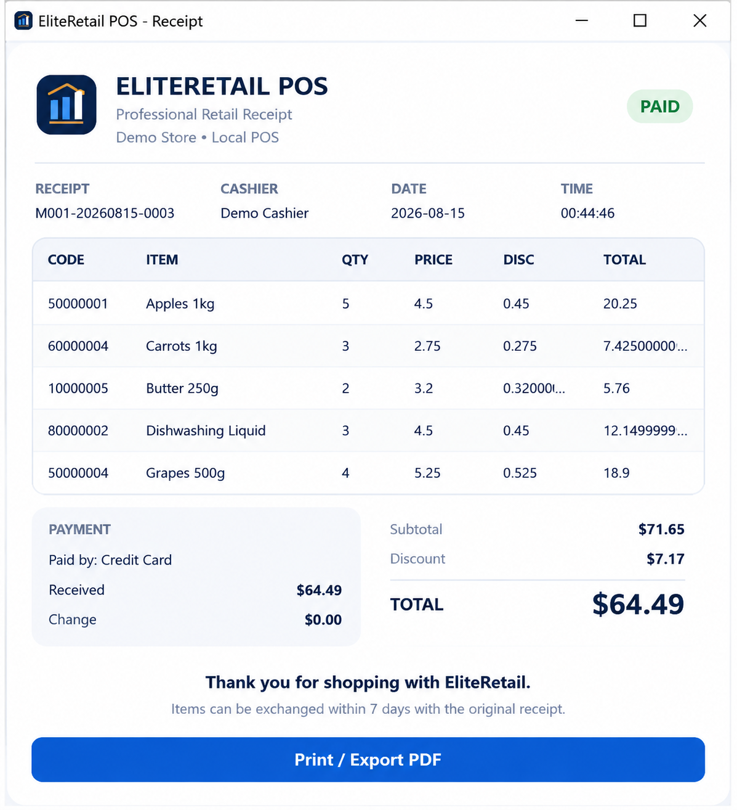
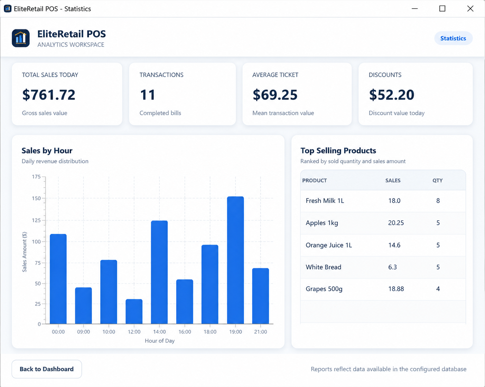

<p align="center">
  
</p>

<h1 align="center">EliteRetail POS System</h1>

<p align="center">
A JavaFX-based Point of Sale and retail management application.
</p>

---

## Overview

EliteRetail POS is a desktop retail management application developed using JavaFX, MySQL, and Maven.

The project focuses on implementing a complete POS workflow, including user authentication, product management, inventory tracking, sales processing, receipt generation, discounts, and sales analytics.

The application follows a layered architecture to separate the user interface, business logic, and database operations.

---
## Motivation

This project was created to practice building a complete desktop application using JavaFX, database integration, and structured software architecture.

## Project Status

Completed

The system is fully functional with:
- Authentication
- Inventory management
- POS checkout
- Receipt generation
- Sales analytics

## Technologies

- Java 21
- JavaFX
- MySQL 8.0
- Maven
- Apache PDFBox
- FXML 
- CSS

---

## Features

### Authentication and Role Management

- User login system
- Role-based access control
- Separate workflows for Manager and Cashier users

Supported roles:

| Role | Access |
|---|---|
| Manager | Dashboard, products, discounts, analytics |
| Cashier | Sales operations and receipts |

---

### Dashboard

The dashboard provides an overview of store activity:

- Revenue summary
- Transaction count
- Product statistics
- Low stock indicators
- Recent transactions
- Sales analytics

---

### Product Management

The product module allows users to:

- Add products
- Update products
- Delete products
- Search products
- Manage categories
- Track stock quantities
- Manage pricing

---

### Discount Management

The system supports different promotion types:

- Percentage discounts
- Fixed amount discounts
- Buy-X-Get-Y promotions

---

### Sales and Checkout

The POS module includes:

- Product search
- Cart management
- Quantity editing
- Discount calculation
- Stock validation
- Multiple payment methods

Supported payment methods:

- Cash
- Credit Card
- Debit Card
- Mobile Payment

---

### Receipt Generation

The application provides:

- Receipt preview
- Transaction records
- PDF receipt export

---

### Statistics and Reports

The statistics module includes:

- Sales charts
- Top-selling products
- Daily sales information
- CSV report export

---

## User Interface

The application uses a consistent JavaFX styling system with reusable components for:

- Buttons
- Forms
- Tables
- Cards
- Dialogs
- Charts

The main color palette:

| Color | Value | Usage |
|---|---|---|
| Primary Navy | `#0B1F3A` | Navigation and branding |
| Secondary Blue | `#1D6FE8` | Actions and highlights |
| Gold Accent | `#D9A441` | Interface accents |
| Background | `#F4F7FB` | Application background |
| Surface | `#FFFFFF` | Cards and tables |

---

## Screenshots

### Splash Screen



### Login



### Dashboard



### Product Management



### Sales Register



### Receipt



### Statistics



---

## Architecture

The project uses a layered architecture:

```
JavaFX / FXML Views

        |

Controller Layer

        |

Service Layer

        |

Repository Layer

        |

Database Connector

        |

MySQL Database
```

The architecture separates:

- User interface code
- Business logic
- Database operations

This makes the application easier to maintain and extend.

---

## Project Structure

```
EliteRetail-POS-System/

├── brand/
│   └── Logo files and application assets
│
├── database/
│   └── pos_db.sql
├── docs/
│   ├── PROJECT_REVIEW.md
│   ├── UI_REDESIGN.md
│   ├── VALIDATION_REPORT.md
│   └── FINAL_POLISH_REPORT.md

├── screenshots/
│
├── src/
│   └── main/
│       ├── java/com/eliteretail/pos/
│       │   ├── app/
│       │   ├── config/
│       │   ├── controller/
│       │   ├── database/
│       │   ├── model/
│       │   ├── repository/
│       │   ├── service/
│       │   └── utils/
│       │
│       └── resources/
│           ├── css/
│           ├── fxml/
│           ├── icons/
│           └── images/
│
├── pom.xml
└── README.md
```
---

## Documentation

Additional engineering documentation is available in the `docs/` folder:

- **PROJECT_REVIEW.md**  
  Detailed review of the original project, architecture improvements, security fixes, database improvements, and refactoring work.

- **UI_REDESIGN.md**  
  Documentation of the EliteRetail POS branding system, interface redesign, color palette, and screen improvements.

- **VALIDATION_REPORT.md**  
  Validation summary covering code checks, FXML integrity, CSS references, and project resource verification.

- **FINAL_POLISH_REPORT.md**  
  Final polishing notes covering the splash screen, documentation organization, and final verification steps.
---

## Requirements

Before running the application:

- JDK 21
- Maven
- MySQL 8.0 or later
- IntelliJ IDEA

Optional:

- Scene Builder

---

## Installation

### 1. Clone the Repository

```bash
git clone https://github.com/raghd-dev/EliteRetail-POS-System.git
```

---

### 2. Setup Database

Create the database using:

```bash
mysql -u root -p < database/pos_db.sql
```

---

### 3. Configure Database Connection

Create a file named:

```
database.properties
```

Add your database information:

```properties
db.url=jdbc:mysql://localhost:3306/pos_db
db.username=your_mysql_username
db.password=your_mysql_password
```

---

### 4. Run the Application

Build the project:

```bash
mvn clean install
```

Run using Maven:

```bash
mvn javafx:run
```

Or run:

```
com.eliteretail.pos.app.Launcher
```

from IntelliJ IDEA.

---

## Demo Accounts

| Role | Username | Password |
|---|---|---|
| Manager | manager001 | manager123 |
| Cashier | cashier001 | cashier123 |

These accounts are included for testing purposes only.

---

## Security

Implemented security practices:

- Prepared SQL statements
- Password hashing support
- Role-based permissions
- Transaction-safe database operations

---

## Testing

Run:

```bash
mvn test
```

---

## Future Improvements

Possible future additions:

- Barcode scanner support
- Customer loyalty system
- Cloud database integration
- Multi-store support
- Employee management
- Additional analytics features

---

## Author

**RAGHD RAFAT**

GitHub:

https://github.com/raghd-dev

---

## License

This project is licensed under the MIT License.